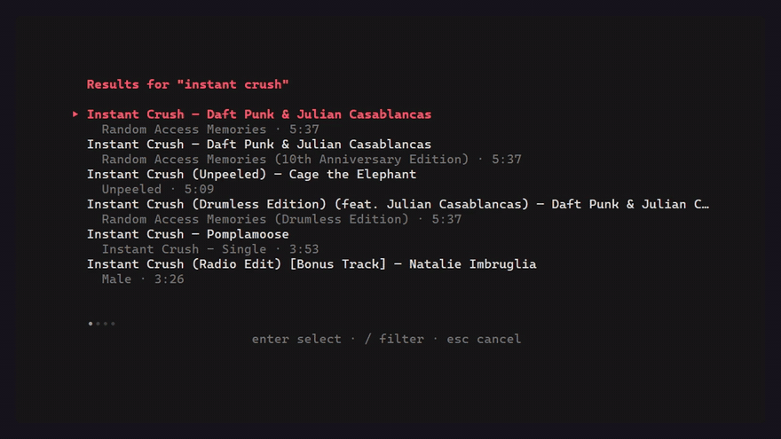

# am — Apple Music in your terminal

A terminal Apple Music client for searching, browsing playlists, and playback.

<p align="center">
  
</p>

<p align="center">
  <a href="https://github.com/kuzhienterprises/AppleMusicTUI/actions/workflows/ci.yml"></a>
  <a href="https://github.com/kuzhienterprises/AppleMusicTUI/releases"></a>
  
  
  <a href="LICENSE"></a>
</p>

## Install

### The installer

macOS and Linux:

```sh
curl -fsSL https://raw.githubusercontent.com/kuzhienterprises/AppleMusicTUI/main/install.sh | sh
```

Windows, in PowerShell:

```powershell
irm https://raw.githubusercontent.com/kuzhienterprises/AppleMusicTUI/main/install.ps1 | iex
```

Both detect your operating system and CPU, download the matching release, verify it against that release's `checksums.txt`, install it to `~/.local/bin` (macOS and Linux) or `%LOCALAPPDATA%\Programs\am` (Windows), add that directory to your `PATH`, and finish by running `am doctor` to report what is still missing. Neither needs administrator rights, and both are short enough to read before you pipe them.

`-Version v0.1.1` or `--version v0.1.1` pins a release, `--dir` installs elsewhere, and `--uninstall` / `-Uninstall` reverses the install. `-WithMpv` on Windows and `--with-mpv` elsewhere install mpv as well.

### Prebuilt binaries

Or download the latest [release](https://github.com/kuzhienterprises/AppleMusicTUI/releases/latest) yourself: archives are `am_<version>_<os>_<arch>.zip` for Windows and `am_<version>_<os>_<arch>.tar.gz` for macOS and Linux, and every release ships `checksums.txt` so you can verify the archive before extracting it.

### With Go

```sh
go install github.com/kuzhienterprises/AppleMusicTUI/cmd/am@latest
```

Ensure `$(go env GOPATH)/bin` is on `PATH` (on Windows, `%USERPROFILE%\go\bin`).

### From source

```sh
git clone https://github.com/kuzhienterprises/AppleMusicTUI
cd AppleMusicTUI
go build -o bin/am ./cmd/am
```

### Let your agent do it

If you use a coding agent that can run shell commands (Claude Code, Codex, Cursor, ...), paste this in:

> Install `am`, the Apple Music terminal client at https://github.com/kuzhienterprises/AppleMusicTUI. Run the installer that repository ships for my platform: `install.sh` on macOS and Linux, `install.ps1` on Windows. It detects the operating system and CPU, verifies the download against the release's `checksums.txt`, installs `am` and puts it on my `PATH`. If that fails, fall back to `go install github.com/kuzhienterprises/AppleMusicTUI/cmd/am@latest`, or to the archive for my platform from the latest release, verified against `checksums.txt`. Then run `am --version` and `am doctor` and report anything still missing, including a Chromium browser or mpv for previews. Never run `am login` and never handle my Apple credentials — signing in is my job. Ask before installing anything else.

## Requirements and playback

A Chromium browser (Chrome or Edge) is needed for sign-in and full-length playback. Full-length playback drives Apple's own web player over the DevTools protocol in a Chrome or Edge window parked off-screen. Nothing decrypts audio or circumvents DRM. When signed out, playback falls back to Apple's 30-second previews through mpv. An Apple Music subscription is needed for full-length tracks and library access.

The real spectrum is Windows-only: WASAPI loopback captures system audio and an FFT produces the bars. On macOS and Linux, the player reports that the spectrum is unavailable instead of faking it. Go 1.26+ is needed only to build from source.

`am doctor` checks the local setup:

```text
✓ settings directory is writable — <config directory>
✓ developer token can be obtained — valid until <date>
✓ signed in to Apple Music — storefront <code>
✓ player daemon — running and warm (pid <pid>, port <port>)
✓ mpv is installed — mpv <version>
✓ a Chromium browser is available — <browser path>
✓ interactive terminal detected — full-screen interface will be used
✓ recommendations can ask a model - OpenAI gpt-6-luna
✓ spectrum can read the audio output — WASAPI loopback on the default output device

✓ Everything needed for search and playback is ready.
```

## Quick start

```sh
am doctor
am login
am playlists
am search "instant crush"
am play "instant crush"
am playlist "Late Night"
am status
```

`login` opens a browser for you to sign in. The app commands are `doctor`, `login`, `status`, `search`, `playlists`, `playlist`, `play`, `recommend` and `config`, plus `daemon` for the warm player described below.

Global flags: `--plain` never takes over the terminal, `--engine auto|full|preview` chooses how playback runs, `--headless` runs the playback browser with no window at all instead of parking one off-screen, `--no-daemon` never keeps a player warm between commands, `--storefront us` pins a storefront, `--verbose` adds diagnostic detail, and `--json` prints machine-readable output on `search`, `playlists` and `status`.

## The warm player

Starting the browser is the slow part of playing a track. Chrome takes a few seconds to open its debugger, Apple's page takes a few more to load, and the decryption handshake takes a few more after that — and none of that work depends on what you asked to play. So `am` does it once and keeps the result.

After the first command, a small background process keeps the browser alive with the player page loaded. The next command attaches to that page instead of starting from scratch, and the first sound arrives in a couple of seconds rather than twenty. The background player is still Apple's own web player doing Apple's own DRM; nothing about what plays changes, only how long you wait for it.

It stops itself after fifteen minutes of not being used. `am daemon --stop` stops it now, `am daemon` starts it in the foreground if you want it warm before you do anything else, and `--no-daemon` turns it off and starts a fresh browser every time.

The warm player is a shortcut, never a dependency: if the browser behind it has gone away, `am` starts a fresh one rather than failing the command.

```sh
am daemon            # keep a warm player in the foreground
am daemon --stop     # stop the background one
```

`am --verbose` prints where the time went, which is the quickest way to see what is slow on your machine:

```text
browser boot: process 3.8s, page target 100ms, MusicKit 5.4s, queue 2.2s, first sound 20.2s (page: DOM 1.8s, load 2.4s)
```

## Controls

| Key | Action |
| --- | --- |
| `space` | Pause or resume |
| `←` `→` | Seek ∓5s, or 30s with `shift` |
| `↑` `↓` | Volume |
| `n` / `p` | Next or previous track |
| `a` | Toggle queue |
| `/` | Search and add to queue |
| `y` | Show or hide lyrics |
| `v` | Toggle spectrum |
| `?` | Show keys |
| `esc` | Close an overlay, then quit |
| `q` | Quit |

## Lyrics

`y` shows the words for the track that is playing. They take the place of the metadata column, so the cover stays where it is and the title and credit sit above the words. The line being sung is held near the middle of the panel and the lines around it are dimmed; they move on their own as the track does, and a new track brings its own words without asking.

The lyrics are Apple's own, timed to the recording, and they come from the catalogue. A track Apple has no lyrics for says so rather than showing an empty panel, and that is the usual answer for instrumentals. Instrumental intros have no line to highlight, so the first line waits at the top until it is sung.

## Recommendations

`am recommend` reads your recently played history from Apple Music, asks an OpenAI model for tracks you have not just played, looks each one up in the catalogue, and plays the ones that exist.

The history is Apple's rather than this terminal's: it is the same list your phone and your laptop contribute to, so the first run already has something to work with. The names of your playlists go with it, because "Late Night" and "Gym" say more per word than another row of track titles. That summary is all the model sees, and it sees it only when you give it a key.

```sh
am config env                    # create the env file, then put OPENAI_API_KEY=sk-... in it
am recommend                     # ask, look up, play
am recommend --count 5 --print   # just the list, with a reason for each
```

A key can live in three places, and the first one that is set wins: `OPENAI_API_KEY` in the environment, the env file `am config env` creates, and the saved settings (`am config set openaiKey`). The env file is a plain `KEY=VALUE` file, owner-only, read before every command, and never sent anywhere except to the model it names. The key goes on its own line, not after the `#` the example uses.

`--model` picks another model, `--window` sets how much history to read (up to 90 plays), and `--json` prints the resolved tracks for a script. A suggestion the catalogue cannot find is reported instead of played, and the artist has to match, so a cover is not passed off as the recording that was meant.

The key is the only part that costs money, and the default model is the cheapest one that is good at this: sixty track names in, ten out, well under a cent.

## Interface

```
╭────────────────────────────────────────────────────────────╮
│  ♫ Apple Music                      1/2   ◖━━━━━━━━○ 100%  │
│                                                            │
│  ▀▀▀▀▀▀▀▀▀▀▀▀▀▀▀▀▀▀▀▀    Varnajaalam                       │
│  ▀▀▀▀▀▀▀▀▀▀▀▀▀▀▀▀▀▀▀▀    Vishnu Vijay +3                   │
│  ▀▀▀▀▀▀▀▀▀▀▀▀▀▀▀▀▀▀▀▀    Bethlehem Kudumba Unit (OST)      │
│  ▀▀▀▀▀▀▀▀▀▀▀▀▀▀▀▀▀▀▀▀                                      │
│  ▀▀▀▀▀▀▀▀▀▀▀▀▀▀▀▀▀▀▀▀    ▂▄▅▆▇█▇▆▅▄▃▂   ▃▅▇█▆▄▂            │
│  ▀▀▀▀▀▀▀▀▀▀▀▀▀▀▀▀▀▀▀▀    ▆██████▇▅▄▃▂▁   ▅███▇▅▃▂          │
│  ▀▀▀▀▀▀▀▀▀▀▀▀▀▀▀▀▀▀▀▀                                      │
│  ▀▀▀▀▀▀▀▀▀▀▀▀▀▀▀▀▀▀▀▀                                      │
│                                                            │
│  ▶  00:23  ━━━━━━●───────────────────────────────── 03:23  │
│                                                            │
│  Up next  ›  Track 2 — Artist                              │
│                                                            │
│  Playing...                                                │
│                                                            │
│  space play   ←→ seek   ↑↓ vol   n/p track                 │
│  a queue   / search   y lyrics   v viz   ? help   q quit   │
╰────────────────────────────────────────────────────────────╯
```

## Troubleshooting

| Issue | What to check |
| --- | --- |
| `am doctor` reports no Chromium browser | Install Chrome or Edge; needed for sign-in and full-length playback. |
| `am doctor` reports no mpv | Install mpv for 30-second preview playback; `am doctor` names the command for your system. |
| `am: command not found` after installing | Open a new terminal so the `PATH` change takes effect. |
| macOS refuses to run `am` | Only archives unzipped through a browser carry the quarantine flag: `xattr -d com.apple.quarantine ~/.local/bin/am`. |
| Full-length playback falls back to previews | Sign in with `am login`; full-length playback requires an active session. |
| Spectrum unavailable | Real spectrum capture is supported on Windows only. |
| `am recommend` says there is no OpenAI key | Set `OPENAI_API_KEY`, or run `am config set openaiKey <key>`. |

## How it works

A Chromium page is started off-screen and never shown; `--headless` skips the window entirely. `am` talks to it over the DevTools protocol, and MusicKit in that page does the catalogue queries and plays full-length tracks through Apple's own player; the terminal is the remote control. A background daemon keeps that page loaded between commands, so the browser is started once rather than once per song. Signed out, previews are played by mpv over an IPC socket, with no browser at all. The spectrum reads the system's audio output through WASAPI loopback on Windows and is reported as unavailable elsewhere.

## Legal

For personal use; not affiliated with or endorsed by Apple. Full-length playback uses Apple's own web player; nothing here decrypts audio or circumvents DRM. Recommendations send a summary of your listening history to OpenAI, and only when you configure a key for them.

## License

[MIT](LICENSE) © 2026 KuzhiEnterprises
