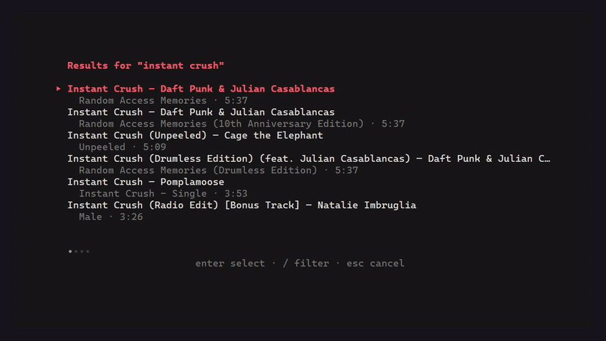

# am — Apple Music in your terminal

A terminal Apple Music client for searching, browsing playlists, and playback.

<p align="center">
  
</p>

<p align="center">
  <a href="https://github.com/kuzhienterprises/AppleMusicTUI/actions/workflows/ci.yml"></a>
  <a href="https://github.com/kuzhienterprises/AppleMusicTUI/releases"></a>
  
  
  <a href="LICENSE"></a>
</p>

## Install

### The installer

macOS and Linux:

```sh
curl -fsSL https://raw.githubusercontent.com/kuzhienterprises/AppleMusicTUI/main/install.sh | sh
```

Windows, in PowerShell:

```powershell
irm https://raw.githubusercontent.com/kuzhienterprises/AppleMusicTUI/main/install.ps1 | iex
```

Both detect your operating system and CPU, download the matching release, verify it against that release's `checksums.txt`, install it to `~/.local/bin` (macOS and Linux) or `%LOCALAPPDATA%\Programs\am` (Windows), add that directory to your `PATH`, and finish by running `am doctor` to report what is still missing. Neither needs administrator rights, and both are short enough to read before you pipe them.

`-Version v0.1.1` or `--version v0.1.1` pins a release, `--dir` installs elsewhere, and `--uninstall` / `-Uninstall` reverses the install. `-WithMpv` on Windows and `--with-mpv` elsewhere install mpv as well.

### Prebuilt binaries

Or download the latest [release](https://github.com/kuzhienterprises/AppleMusicTUI/releases/latest) yourself: archives are `am_<version>_<os>_<arch>.zip` for Windows and `am_<version>_<os>_<arch>.tar.gz` for macOS and Linux, and every release ships `checksums.txt` so you can verify the archive before extracting it.

### With Go

```sh
go install github.com/kuzhienterprises/AppleMusicTUI/cmd/am@latest
```

Ensure `$(go env GOPATH)/bin` is on `PATH` (on Windows, `%USERPROFILE%\go\bin`).

### From source

```sh
git clone https://github.com/kuzhienterprises/AppleMusicTUI
cd AppleMusicTUI
go build -o bin/am ./cmd/am
```

### Let your agent do it

If you use a coding agent that can run shell commands (Claude Code, Codex, Cursor, ...), paste this in:

> Install `am`, the Apple Music terminal client at https://github.com/kuzhienterprises/AppleMusicTUI. Run the installer that repository ships for my platform: `install.sh` on macOS and Linux, `install.ps1` on Windows. It detects the operating system and CPU, verifies the download against the release's `checksums.txt`, installs `am` and puts it on my `PATH`. If that fails, fall back to `go install github.com/kuzhienterprises/AppleMusicTUI/cmd/am@latest`, or to the archive for my platform from the latest release, verified against `checksums.txt`. Then run `am --version` and `am doctor` and report anything still missing, including a Chromium browser or mpv for previews. Never run `am login` and never handle my Apple credentials — signing in is my job. Ask before installing anything else.

## Requirements and playback

A Chromium browser (Chrome or Edge) is needed for sign-in and full-length playback. Full-length playback drives Apple's own web player over the DevTools protocol in a Chrome or Edge window parked off-screen. Nothing decrypts audio or circumvents DRM. When signed out, playback falls back to Apple's 30-second previews through mpv. An Apple Music subscription is needed for full-length tracks and library access.

The real spectrum is Windows-only: WASAPI loopback captures system audio and an FFT produces the bars. On macOS and Linux, the player reports that the spectrum is unavailable instead of faking it. Go 1.26+ is needed only to build from source.

`am doctor` checks the local setup:

```text
✓ settings directory is writable — <config directory>
✓ developer token can be obtained — valid until <date>
✓ signed in to Apple Music — storefront <code>
✓ mpv is installed — mpv <version>
✓ a Chromium browser is available — <browser path>
✓ interactive terminal detected — full-screen interface will be used
✓ spectrum can read the audio output — WASAPI loopback on the default output device

✓ Everything needed for search and playback is ready.
```

## Quick start

```sh
am doctor
am login
am playlists
am search "instant crush"
am play "instant crush"
am playlist "Late Night"
am status
```

`login` opens a browser for you to sign in. The app commands are `doctor`, `login`, `status`, `search`, `playlists`, `playlist`, and `play`.

Global flags: `--plain` never takes over the terminal, `--engine auto|full|preview` chooses how playback runs, `--storefront us` pins a storefront, `--verbose` adds diagnostic detail, and `--json` prints machine-readable output on `search`, `playlists` and `status`.

## Controls

| Key | Action |
| --- | --- |
| `space` | Pause or resume |
| `←` `→` | Seek ∓5s, or 30s with `shift` |
| `↑` `↓` | Volume |
| `n` / `p` | Next or previous track |
| `a` | Toggle queue |
| `/` | Search and add to queue |
| `v` | Toggle spectrum |
| `?` | Show keys |
| `esc` | Close an overlay, then quit |
| `q` | Quit |

## Interface

```
╭────────────────────────────────────────────────────────────╮
│  ♫ Apple Music                      1/2   ◖━━━━━━━━○ 100%  │
│                                                            │
│  ▀▀▀▀▀▀▀▀▀▀▀▀▀▀▀▀▀▀▀▀    Varnajaalam                       │
│  ▀▀▀▀▀▀▀▀▀▀▀▀▀▀▀▀▀▀▀▀    Vishnu Vijay +3                   │
│  ▀▀▀▀▀▀▀▀▀▀▀▀▀▀▀▀▀▀▀▀    Bethlehem Kudumba Unit (OST)      │
│  ▀▀▀▀▀▀▀▀▀▀▀▀▀▀▀▀▀▀▀▀                                      │
│  ▀▀▀▀▀▀▀▀▀▀▀▀▀▀▀▀▀▀▀▀    ▂▄▅▆▇█▇▆▅▄▃▂   ▃▅▇█▆▄▂            │
│  ▀▀▀▀▀▀▀▀▀▀▀▀▀▀▀▀▀▀▀▀    ▆██████▇▅▄▃▂▁   ▅███▇▅▃▂          │
│  ▀▀▀▀▀▀▀▀▀▀▀▀▀▀▀▀▀▀▀▀                                      │
│  ▀▀▀▀▀▀▀▀▀▀▀▀▀▀▀▀▀▀▀▀                                      │
│                                                            │
│  ▶  00:23  ━━━━━━●───────────────────────────────── 03:23  │
│                                                            │
│  Up next  ›  Track 2 — Artist                              │
│                                                            │
│  Playing...                                                │
│                                                            │
│  space play   ←→ seek   ↑↓ vol   n/p track                 │
│  a queue   v viz   ? help   q quit                         │
╰────────────────────────────────────────────────────────────╯
```

## Troubleshooting

| Issue | What to check |
| --- | --- |
| `am doctor` reports no Chromium browser | Install Chrome or Edge; needed for sign-in and full-length playback. |
| `am doctor` reports no mpv | Install mpv for 30-second preview playback; `am doctor` names the command for your system. |
| `am: command not found` after installing | Open a new terminal so the `PATH` change takes effect. |
| macOS refuses to run `am` | Only archives unzipped through a browser carry the quarantine flag: `xattr -d com.apple.quarantine ~/.local/bin/am`. |
| Full-length playback falls back to previews | Sign in with `am login`; full-length playback requires an active session. |
| Spectrum unavailable | Real spectrum capture is supported on Windows only. |

## How it works

A Chromium page is started off-screen and never shown. `am` talks to it over the DevTools protocol, and MusicKit in that page does the catalogue queries and plays full-length tracks through Apple's own player; the terminal is the remote control. Signed out, previews are played by mpv over an IPC socket, with no browser at all. The spectrum reads the system's audio output through WASAPI loopback on Windows and is reported as unavailable elsewhere.

## Legal

For personal use; not affiliated with or endorsed by Apple. Full-length playback uses Apple's own web player; nothing here decrypts audio or circumvents DRM.

## License

[MIT](LICENSE) © 2026 KuzhiEnterprises
