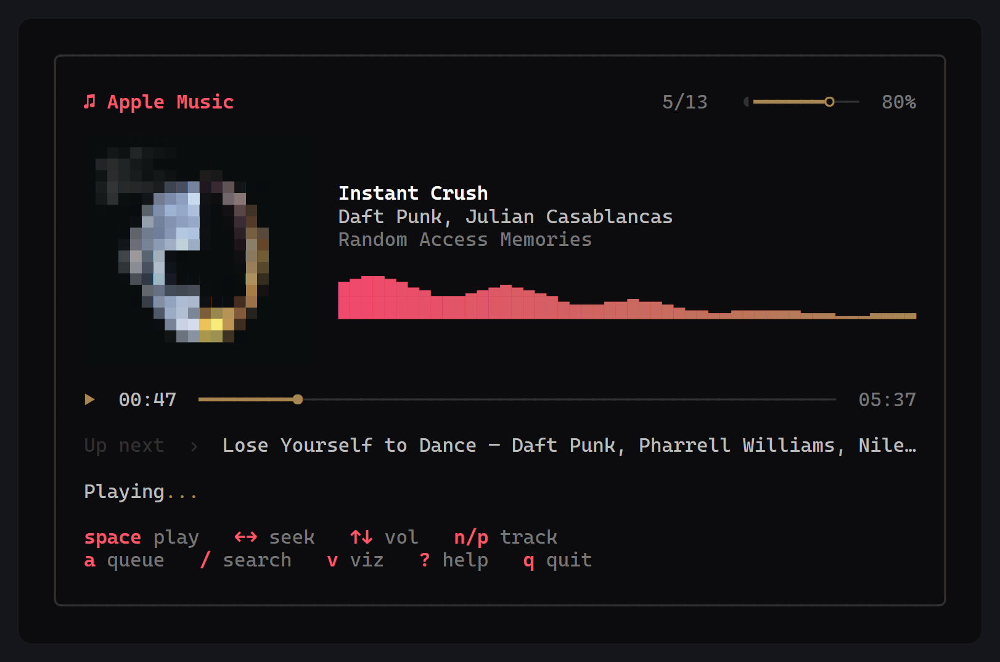
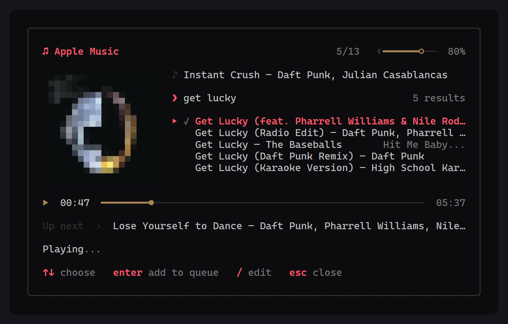
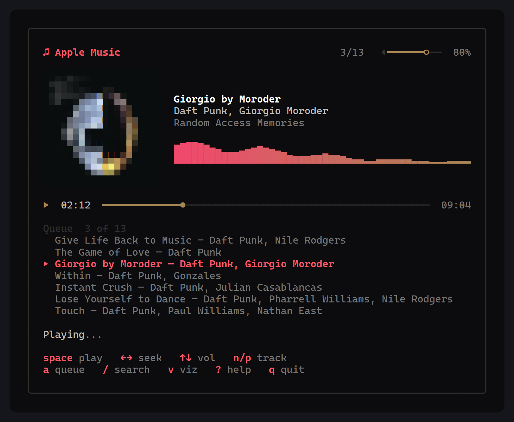
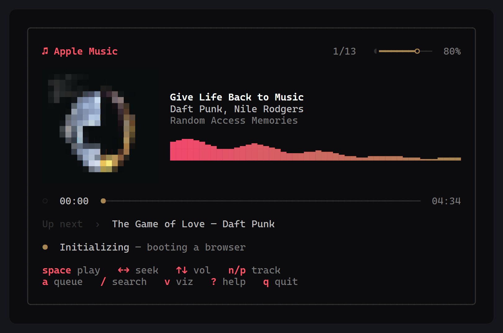

# am — Apple Music in your terminal

An Apple Music client that lives in the terminal. Sign in through your own
browser, browse your library playlists, search the catalogue, and play
**full-length** tracks with no window ever appearing.

<p align="center">
  
</p>

<p align="center">
  <a href="https://github.com/kuzhienterprises/AppleMusicTUI/actions/workflows/ci.yml"></a>
  <a href="https://github.com/kuzhienterprises/AppleMusicTUI/releases"></a>
  
  
  <a href="LICENSE"></a>
</p>

- **Full-length playback, not previews.** Apple's own web player does the
  decoding, out of sight, and the terminal drives it.
- **A spectrum that is real.** System audio is captured with WASAPI loopback and
  put through an FFT, so the bars follow the music.
- **Album art in half blocks.** Fetched from Apple's CDN, averaged down to
  20×20, and used to tint the whole player with the cover's colour.
- **Queue without stopping.** Search the catalogue from inside the player and
  append to what is playing.
- **Degrades honestly.** No capture device, no cover, a small window — the
  player says what it is missing and keeps going.

---

## Install

### Prebuilt binaries

Every [release](https://github.com/kuzhienterprises/AppleMusicTUI/releases) carries
Windows, macOS and Linux builds for `amd64` and `arm64`, with a `checksums.txt`
alongside them.

Grab the archive for your platform — `am_<version>_<os>_<arch>.zip` on Windows,
`.tar.gz` elsewhere — unpack it, and put `am` somewhere on your `PATH`:

```powershell
# Windows
Expand-Archive am_0.1.0_windows_amd64.zip -DestinationPath "$env:USERPROFILE\bin"
```

```sh
# macOS and Linux
tar xzf am_0.1.0_linux_amd64.tar.gz -C ~/.local/bin
```

### With Go

```sh
go install github.com/kuzhienterprises/AppleMusicTUI/cmd/am@latest
```

That drops `am` in `$(go env GOPATH)/bin`, which is `%USERPROFILE%\go\bin` on
Windows.

### From source

```sh
git clone https://github.com/kuzhienterprises/AppleMusicTUI
cd AppleMusicTUI
go build -o bin/am ./cmd/am
```

## Requirements

| Requirement | Notes |
| --- | --- |
| Go 1.26+ | Only to build. `winget install GoLang.Go` |
| Chrome or Edge | Sign-in, and the hidden player that decodes full-length audio. Any Chromium browser will do |
| mpv | `winget install mpv-player.mpv-CI.MSVC`. Used when playing 30 second previews |
| Apple Music subscription | Needed for full-length tracks and your library. Previews work without an account |
| Windows | For the spectrum. Everything else also runs on macOS and Linux |

`am doctor` checks all of it and tells you what is missing:

```text
✓ settings directory is writable — C:\Users\you\AppData\Roaming\applemusic-cli
✓ developer token can be obtained — valid until 2026-12-22
✓ signed in to Apple Music — storefront in
✓ mpv is installed — mpv 0.41.0
✓ a Chromium browser is available — C:\Program Files\Google\Chrome\Application\chrome.exe
✓ interactive terminal detected — full-screen interface will be used
✓ spectrum can read the audio output — WASAPI loopback on the default output device

✓ Everything needed for search and playback is ready.
```

## Quick start

```sh
am login          # opens your browser once; the session is captured automatically
am doctor         # verify everything above
am playlists      # pick a library playlist
am search "instant crush"   # pick a catalogue result
am play "instant crush"     # or jump straight to the best match
am playlist "Late Night"    # a library or catalogue playlist by name
am status         # session, storefront, token expiry, mpv path
am logout --purge # forget the session and delete the browser profile
```

## Controls

| Key | Action |
| --- | --- |
| `space` | Pause / resume |
| `←` `→` | Seek ∓5s, or 30s with `shift` |
| `↑` `↓` | Volume |
| `n` `p` | Next / previous track |
| `a` | Show or hide the queue |
| `/` | Search the catalogue and add to the queue |
| `v` | Show or hide the spectrum |
| `?` | Show every key |
| `esc` | Close an overlay, then quit |
| `q` | Quit |

Useful flags, on every command unless noted:

| Flag | Purpose |
| --- | --- |
| `--plain` | Never take over the terminal; print instead |
| `--engine auto\|full\|preview` | `auto` plays full tracks when signed in, previews otherwise |
| `--storefront xx` | Pin a storefront, e.g. `us`, `in`, `gb` |
| `-v, --verbose` | Diagnostic detail, including live playback position |
| `--json` | Machine-readable output (`search`, `playlists`, `status`) |
| `--stop-after 30m` | Sleep timer (`play`, `search`, `playlist`, `playlists`) |
| `--all` | Queue every match rather than the best one (`play`, `search`) |

## Screenshots

<p align="center">
  
</p>

Searching from inside the player swaps the panel into the details column, so the
card never resizes and what is playing stays on screen. Results already queued
carry a tick.

<p align="center">
  
</p>

The queue shows the whole run, with the current track marked:

<p align="center">
  
</p>

---

## Playback: read this first

`am` plays **full-length tracks** from your subscription, and nothing appears on
screen while it does.

Apple delivers full-length audio as **encrypted HLS**, and the decryption key is
released only to a licensed Content Decryption Module — Widevine inside Chrome
and Edge, FairPlay inside Safari and Apple's apps. A player like mpv has no CDM,
and Go has no way to provide one, so the bytes stay encrypted no matter what.

Rather than fight that, `am` hands playback to a browser and drives it:

- A Chromium window opens **off-screen** (`--window-position=-32000,-32000`),
  signed in from the profile `am login` created.
- The CLI attaches to it over the DevTools protocol and calls Apple's own
  **MusicKit** player — the same object the web player uses.
- Chrome's CDM negotiates the Widevine licence, Apple's key decrypts the audio,
  and the terminal sends pause, seek, volume and track changes.

This only works inside a real Apple Music page: the developer token is
origin-bound to `music.apple.com`, so the scripts have to run there rather than
on a page we serve ourselves.

If you are **not signed in**, `am` falls back to Apple's plain 30-second preview
clips, which need no CDM and play directly through mpv.

## The interface

```
╭────────────────────────────────────────────────────────────╮
│  ♫ Apple Music                      1/2   ◖━━━━━━━━○ 100%  │
│                                                            │
│  ▀▀▀▀▀▀▀▀▀▀▀▀▀▀▀▀▀▀▀▀    Varnajaalam                       │
│  ▀▀▀▀▀▀▀▀▀▀▀▀▀▀▀▀▀▀▀▀    Vishnu Vijay +3                   │
│  ▀▀▀▀▀▀▀▀▀▀▀▀▀▀▀▀▀▀▀▀    Bethlehem Kudumba Unit (OST)      │
│  ▀▀▀▀▀▀▀▀▀▀▀▀▀▀▀▀▀▀▀▀                                      │
│  ▀▀▀▀▀▀▀▀▀▀▀▀▀▀▀▀▀▀▀▀    ▂▄▅▆▇█▇▆▅▄▃▂   ▃▅▇█▆▄▂ │
│  ▀▀▀▀▀▀▀▀▀▀▀▀▀▀▀▀▀▀▀▀    ▆██████▇▅▄▃▂▁   ▅███▇▅▃▂  │
│  ▀▀▀▀▀▀▀▀▀▀▀▀▀▀▀▀▀▀▀▀                                      │
│  ▀▀▀▀▀▀▀▀▀▀▀▀▀▀▀▀▀▀▀▀                                      │
│                                                            │
│  ▶  00:23  ━━━━━━●───────────────────────────────── 03:23 │
│                                                            │
│  Up next  ›  Track 2 — Artist                              │
│                                                            │
│  Playing...                                                │
│                                                            │
│  space play   ←→ seek   ↑↓ vol   n/p track                 │
│  a queue   v viz   ? help   q quit                         │
╰────────────────────────────────────────────────────────────╯
```

Five things are worth calling out:

- **The cover is real.** It is fetched from Apple's CDN and drawn with `▀`,
  using the foreground for the top half of each cell and the background for the
  bottom half, which doubles the vertical resolution. The average colour of the
  cover then tints the progress bar and the far end of the spectrum's gradient,
  so the player takes on something of the album it is playing.
- **The spectrum is two rows.** Eighth-block glyphs give eight heights per row,
  so two rows give sixteen steps, and the lower row is drawn first so the upper
  one stacks on top of it.
- **The layout gives things up rather than squashing them.** Under about 68
  columns the cover is dropped, and a little below that the spectrum follows. On
  a short terminal the blank lines go first, then the cover, then the transport
  report, then the key footer — a frame taller than the terminal would scroll
  the alternate screen and take its own top border with it.
- **The artist line is shortened.** Apple returns the whole credit as one
  string; a four-name credit is folded to `Vishnu Vijay +3`.
- **The status line animates.** A point grows into a circle and back while the
  engine boots, and `Playing` carries dots that keep moving while a track does,
  so a stalled engine looks different from a quiet one. A short card gives the
  transport report up before it gives the keys up.

### Adding to the queue while it plays

`/` opens a search panel inside the player: type a query, press enter, and the
results appear in the column the track details were in. `↑`/`↓` chooses, and
enter adds the chosen track to the end of the queue without interrupting what is
playing. A tick marks each result that has been added, so several can be picked
in a row, and the track counter in the header grows with them.

Selecting a search result queues **only that result**. A list of candidates is
not a playlist: picking one of twenty tracks called "Mercy" should not put the
other nineteen behind it. `am search --all` queues the whole list instead.

With one track in the queue there is nowhere to skip to, so `n`/`p` do nothing
until the queue is longer. `/` is how it gets longer, and the "Up next" line
says so.

## The spectrum

The bars are a real spectrum, not a decoration. On Windows the player captures
the default output device with WASAPI loopback, runs a 2048-point FFT over it
about 25 times a second, and folds the result into 32 logarithmically spaced
bands from 40 Hz to 16 kHz. Each band is tilted, smoothed with a fast attack and
a slow release so the bars fall rather than snap, and drawn twice over — once in
eighth blocks for height, and once across a gradient that runs from Apple's pink
to a warm tone, or to the cover's colour when there is one.

Because it listens to the *output device* rather than to this player, two things
follow:

- Any other sound on the machine shows up too. A video playing in another window
  will move the bars.
- It works for both engines, so previews through mpv light it up exactly like
  full-length playback.

Nothing is recorded: the capture buffer is folded into 32 numbers and thrown
away, and those numbers only exist in memory while the player is on screen.

Where the device cannot be opened — or on platforms other than Windows — the
player draws a labelled stand-in animation instead and says so on the metadata
line, rather than pretending. `am doctor` reports which one you will get.

## How it works

Three mechanisms do the heavy lifting:

1. **Developer token** — every catalogue request needs an ES256 JWT. No Apple
   Developer account is required: the token is scraped from the Apple Music web
   player's JS bundle (`music.apple.com/assets/index~*.js`, the one issued to
   `AMPWebPlay`). It lasts about 70 days and is refreshed automatically. That
   token is origin-bound, so requests send `Origin: https://music.apple.com` —
   without it, Apple answers 401.

2. **Music user token** — library access needs a token stored in the
   `media-user-token` cookie. `am login` launches your own Chrome against a
   dedicated profile, waits for the cookie, and verifies it. Because it uses
   Apple's real origin, the origin-bound token rules are satisfied and your
   everyday browsing profile is never touched.

3. **Playback** — two engines sit behind one interface. *Full-length* launches a
   Chromium window off-screen with the sign-in profile, attaches over the
   DevTools protocol, raises the page and gives it emulated focus (Chrome
   throttles occluded pages hard enough to stall audio), then drives MusicKit's
   `setQueue` / `play` / `seekToTime` / `skipToNextItem`. *Previews* launches mpv
   with `--input-ipc-server` and drives it over that socket (a named pipe on
   Windows). Adding to the queue mid-playback goes through the same two doors:
   `playLater` on the MusicKit side, and `loadfile … append` on mpv's.

Both queue calls are confirmed rather than assumed. MusicKit resolves a queue
change asynchronously and applies it separately, so the player watches the
length the queue reports until it reaches what was asked for; if Apple refuses
the ids, the error surfaces under the search box and the queue is left as it
was.

The two engines are isolated behind one small interface, so commands, the
interface and the queue code never need to know which one is running.

Because library tracks are queued by their library id, songs that the current
storefront's catalogue does not carry still play — Apple resolves either id space
natively.

The spectrum is a fourth, independent piece: it never talks to the engines, only
to the audio device. `internal/visualizer` holds the analyser, which is pure Go
and tested against a synthetic tone, and the Windows capture loop. If capture is
unavailable the interface is handed a stand-in with `Live() == false` and labels
it, so the player always has something coherent to draw.

The cover is a fifth: `internal/artwork` substitutes the `{w}`/`{h}` placeholders
in Apple's artwork URL, downloads the result, averages it down to 20×20 (a box
filter, because nearest-neighbour on that grid looks like static) and picks the
accent colour from it. Downloads happen off the update loop and are cached by
URL, so walking back and forth through a queue costs nothing.

## Platform support

| | Windows | macOS | Linux |
| --- | --- | --- | --- |
| Search, playlists, the player | ✅ | ✅ | ✅ |
| Full-length playback (hidden browser) | ✅ | ✅ | ✅ |
| Preview playback (mpv) | ✅ | ✅ | ✅ |
| Real spectrum (WASAPI loopback) | ✅ | labelled stand-in | labelled stand-in |

The hidden player, mpv and the layout are platform-neutral Go. The spectrum is
the Windows-specific piece: capture lives behind `loopback_windows.go` with a
stand-in behind `loopback_other.go`. On macOS and Linux the app does everything
else and says on screen that the bars are an animation. Everything compiles
everywhere, and CI builds every target on each push.

## Configuration

Tokens live outside the repository:

```
%APPDATA%\applemusic-cli\config.json       # Windows: credentials and settings
%APPDATA%\applemusic-cli\browser-profile\  # the dedicated sign-in profile
```

On macOS and Linux the same files sit in `$XDG_CONFIG_HOME/applemusic-cli`, or
`~/.config/applemusic-cli` when that is unset.

| Key | Meaning |
| --- | --- |
| `devToken`, `devTokenExp` | Scraped developer token and its expiry |
| `musicUserToken` | Captured session token (a secret) |
| `storefront` | Two-letter country code |
| `mpvPath` | Override mpv autodetection |

## Troubleshooting

**`mpv was not found`** — install it, or point the CLI at it:
`am doctor` reports what is missing.

**Colours look wrong** — Windows Terminal is recommended. Legacy `conhost`
often lacks virtual terminal support.

**`401` from the API** — the session expired. Run `am login` again.

**Search returns nothing** — the storefront decides what is available. Try
pinning one: `am --storefront in search "..."`.

**Login window never detects sign-in** — make sure you complete the Apple ID
sign-in *and* land back on the Apple Music player. As a fallback you can supply
a token manually: `am login --token <value>`.

**Full-length playback quietly becomes previews** — the sign-in profile lost its
session. Run `am login` again. The player says so on screen when it notices.

**A window flashes on startup** — that is the hidden browser opening. It moves
off-screen immediately. `--engine preview` uses mpv instead and never opens one.

**Playback is silent but the progress bar moves** — the browser is decoding
fine, so the sound is being swallowed downstream. Chrome's output device is a
*Windows per-app setting*: open the Volume mixer (right-click the taskbar
speaker), find **Google Chrome**, and check both its volume slider and its output
device. Also confirm the system's default output is the one you are listening on
— a virtual device such as FxSound, or Bluetooth earbuds that are switched off,
will quietly eat the audio.

**The first track takes a few seconds** — the hidden browser has to start and
Apple's player has to boot. The status line under the queue says `Initializing`
next to a pulse that grows from a point into a circle, and turns into `Playing`
with dots that keep moving once the music is actually going. A line that has
stopped moving means the engine has stopped answering. After that first boot,
later tracks start instantly.

<p align="center">
  
</p>

**…but on a slow machine it may give up first** — that boot has a 90 second
ceiling, and a genuinely cold one (Chrome unpacking a profile, fetching Apple's
player bundle, starting a decoder, with a slow disk) can come close to it. Raise
the ceiling and it will wait:

```sh
AM_BROWSER_TIMEOUT=3m am play "instant crush"
```

**The spectrum says it is a stand-in** — system audio could not be captured, so
the bars are an animation rather than your music. `am doctor` says why; the
usual cause is another application holding the output device in exclusive mode.

**No album art** — the cover comes from Apple's image CDN, not from the playback
engine, so it needs network access even when a track is already playing. If the
download fails the slot stays as an empty block and everything else carries on.

**The layout is missing pieces** — that is the window being small. The cover
goes first, then the spectrum, then the blank lines, then the key footer. Make
the window bigger, or press `?` to see the keys without the footer. The key list
itself stops when the window cannot hold it and says how many are left.

**A track will not add to the queue** — Apple resolves the id when it applies
the change, so a track the current storefront does not carry comes back as
`NOT_FOUND`. The message appears under the search box, playback carries on, and
the queue is left exactly as it was. Try the catalogue id, or pin a storefront
with `am --storefront in play`.

## Roadmap

- A resident player daemon, so the first track starts instantly and
  `pause`/`next` work across invocations.
- Shuffle and repeat, which need control-surface work on both engines.
- Synced lyrics, which Apple exposes through the same MusicKit object the player
  already drives.
- Catalogue albums, artists and radio.
- Kitty and Sixel artwork, for terminals whose graphics protocols beat half
  blocks. Half blocks work everywhere, which is why they came first.

## Contributing

Bug reports and playback fixes are welcome — see [CONTRIBUTING.md](CONTRIBUTING.md).
If you change anything around playback, say in the pull request what you heard
and on which platform: that is the part CI cannot check. Security notes are in
[SECURITY.md](SECURITY.md).

## Legal

The developer token is read from the Apple Music web player. Full-length
playback uses Apple's own web player and its licensed Widevine module, exactly as
a browser does; nothing here decrypts audio or extracts keys, and Apple's DRM is
not circumvented. The project is for personal use, and is not affiliated with or
endorsed by Apple.

## License

[MIT](LICENSE) © 2026 KuzhiEnterprises
